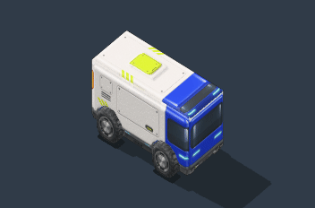
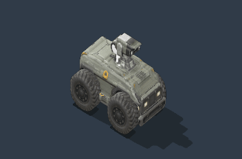
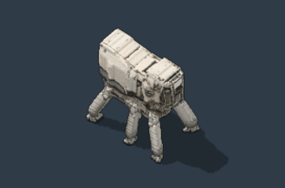
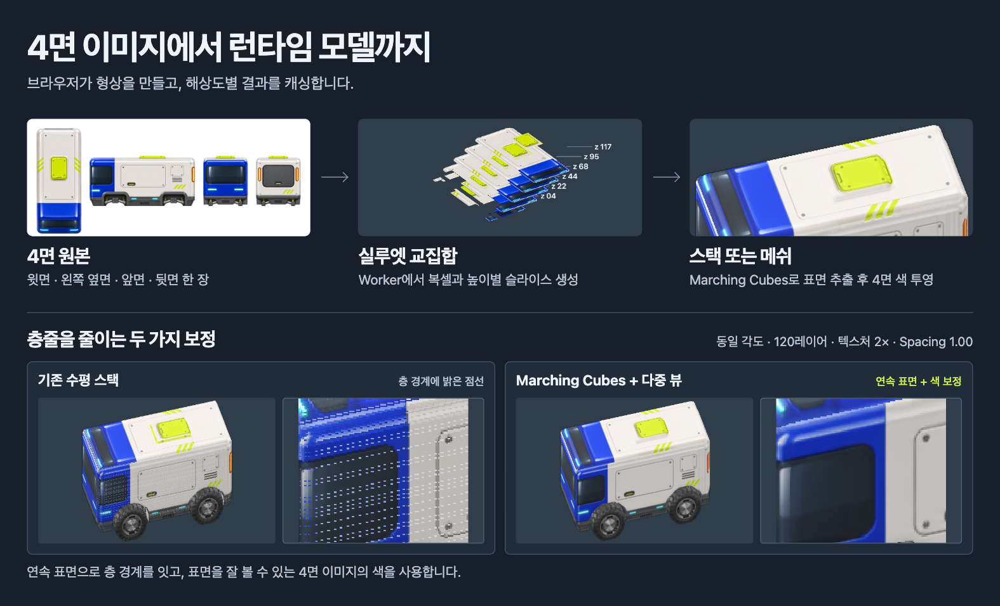

# Sprite Stacking Test

Drive a four-wheel cargo rover, an inspection robot, or a six-legged ant mech through a test yard. The browser reconstructs vehicles from four-view PNGs and lets you compare sprite stacking, Marching Cubes, and multi-view texturing in real time.

## Model Turntables

<p align="center">
  
  
  
</p>

<p align="center">Cargo Rover · Inspection Robot · Ant Mech</p>

## How to Play

Paste the command for your system to download the standalone HTML and open it in your browser. The demo runs offline after download.

**macOS Terminal**

```sh
demo="$(mktemp -d)/index.html" && curl -fL 'https://raw.githubusercontent.com/ev3rlit/sprite-stacking-test/refs/heads/main/dist/index.html' -o "$demo" && open "$demo"
```

**Windows PowerShell**

```powershell
& { $demo = Join-Path $env:TEMP 'sprite-stacking-demo.html'; curl.exe -fL 'https://raw.githubusercontent.com/ev3rlit/sprite-stacking-test/refs/heads/main/dist/index.html' -o $demo; if ($LASTEXITCODE -eq 0) { Start-Process $demo } }
```

You can also open the [standalone HTML file on GitHub](https://github.com/ev3rlit/sprite-stacking-test/blob/main/dist/index.html), select **Download raw file**, and double-click the saved file.

### Controls

Select a model using the vehicle icons. Use **WASD** or the **arrow keys** to move, **Space** to stop, and **R** to reset.

| Model | Special controls |
| --- | --- |
| Cargo Rover | **Shift** boosts. |
| Inspection Robot | **E** scans nearby props. |
| Ant Mech | Aim with the mouse. **Q / E** rotate the body, and **F** triggers a leap. |

## Runtime Workflow



1. **Four-view input.** The browser splits the [rover body PNG](assets/rover/fillet-rover-body-4-view.png) into top, left, front, and rear views. The wheels are reconstructed from a separate four-view image so they can steer and spin around their own axles.
2. **Runtime reconstruction and caching.** A Web Worker intersects the four silhouettes to generate a voxel volume and horizontal slices. The layer count controls vertical resolution, while texture scale controls the horizontal grid. The demo reuses matching results from memory or IndexedDB when available.
3. **Stack or mesh rendering.** The renderer draws the horizontal slices or uses Marching Cubes to extract a continuous triangle surface from the voxel volume. Multi-view texturing weights source colors by surface orientation and visibility, then blends similar colors.

### Reducing Layer Banding

At some angles, the horizontal stack exposes slice edges. In the example above, bright colors from the front image repeat along adjacent slice edges, producing dotted bands. Marching Cubes connects the layers with a continuous surface. Multi-view texturing reprojects source colors onto that surface. You can toggle each technique independently in **Rendering**.

The before-and-after captures use the same angle, 120 layers, 2× texture resolution, and spacing of 1.00. The close-ups show the combined effect of both techniques.

### Anti-Aliasing and Performance

The shared controls let you toggle 2× supersampling, Subpixel AA, and Specular AA independently. Supersampling renders at twice the screen resolution along each axis before downsampling. Subpixel AA samples coverage at four points per pixel along model and prop edges. Specular AA reduces shimmer from rapid normal changes under material lighting.

The performance panel updates every 400 ms and shows FPS, frame time, and render CPU time. It starts a fresh measurement after you change an AA or supersampling setting.

## Build and Test

Use Node.js 20 or later.

```sh
npm run build
npm test
```

Open `dist/index.html` in a browser to play the new build.

## Repository Layout

- `src/` contains the UI, runtime, reconstruction worker, and asset catalog.
- `assets/` contains four-view PNGs, slices, and concept images.
- `examples/` contains earlier standalone demos.
- `dist/index.html` is the standalone build for downloads and static hosting.

See the [asset notes](ASSET-NOTES.md) for the source layout. Rebuild the standalone file after changing runtime code or bundled assets.
